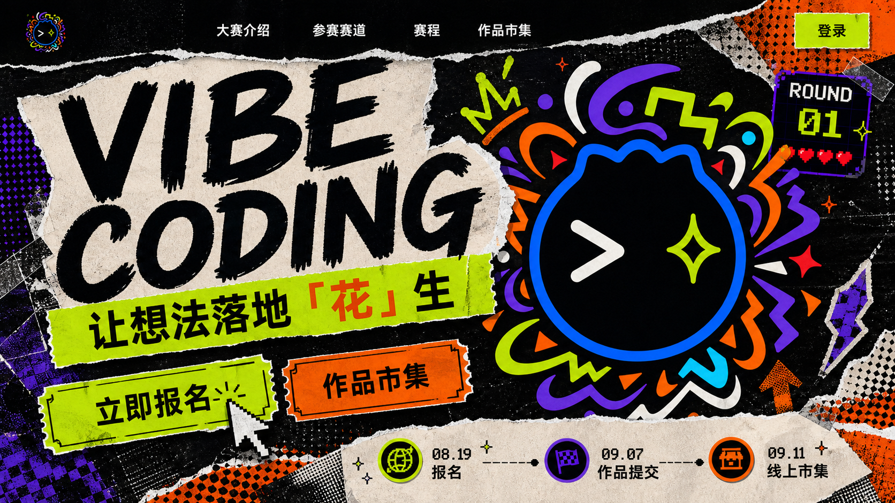

# PIXEL STREET MARKET｜像素街头创作市集

> 主题融合提案 v2.0：05 Street Collage 70% + 03 Pixel Arcade 30%



## V2 冲击力修正

V1 的像素 HUD、手机预览和矩形分栏过于完整，让页面更像一套潮流游戏 UI，削弱了 05 Street Collage 的海报冲击。V2 做出四项调整：

- 从「设计展示板」改为单一全屏网页，取消手机预览、右侧栏和均匀卡片网格。
- `VIBE CODING` 放大到越界，Logo 与标题互相遮挡，形成一个不可拆分的第一视觉。
- 撕纸、荧光色块与票根按钮改用大面积碰撞，减少零碎装饰和规整留白。
- 像素元素退到 `ROUND 01`、日期、鼠标和局部反馈，不再决定页面结构。

V1 预览保留在 [`pixel-street-market.png`](./pixel-street-market.png)，用于前后对比。

## 一句话定位

把大赛包装成一场正在城市街角发生的「创作市集」：街头拼贴负责青春感、传播感和叙事，像素游戏语言负责轮次、进度、登录、报名与投票反馈。

它不是硬核编程赛，也不是复古游戏站，而是一个让普通员工愿意加入、展示和分享作品的轻竞技舞台。

## 70 / 30 融合原则

### 70%｜Street Collage：决定网站气质

- 页面结构采用不对称海报构图，大标题、作品卡和视觉符号有明显层级。
- 主要材质使用撕纸边缘、胶带、网点印刷、荧光贴纸、粗记号笔线条。
- 主按钮像活动票根，内容区像张贴在墙面的海报或作品卡片。
- 页面切换与分区采用纸张叠放和裁切关系，不依赖规整的科技网格。
- 主文案采用大字、短句、强对比，强调「人人都能创作」而非技术门槛。

### 30%｜Pixel Arcade：承担功能反馈

- `ROUND 01`、报名状态、倒计时、时间轴和投票结果使用像素 HUD 语言。
- 小图标、角标、鼠标指针、进度条和 hover 反馈使用像素颗粒或逐格动画。
- 作品票数可用像素心形、闪光或能量槽表达，但正文和长文不使用像素字体。
- 像素元素始终是信息组件，不把整页做成游戏菜单，也不铺满像素背景。

## 大赛内容映射

- 活动名称：Vibe Coding 创作大赛
- 核心表达：让想法落地「花」生
- 活动气质：公司范围个人参与，轻竞技、重展示，不做编程培训或纯技术比赛。
- 三条赛道：业务实战、生活工具、艺术游戏。
- 关键节点：08.19 报名、09.07 作品提交、09.11 线上作品市集。
- 投票规则：同一用户对同一作品只能投一次，可以为多个不同作品投票。

## 首页骨架

```text
┌──────────────────────────────────────────────────────┐
│ LOGO   大赛介绍  参赛赛道  赛程  作品市集     登录 │
├──────────────────────────────────────────────────────┤
│ HERO                                                 │
│ VIBE CODING          主视觉 Logo / 拼贴图形          │
│ 让想法落地「花」生   ROUND 01 状态贴纸               │
│ [立即报名] [作品市集]                                │
├──────────────────────────────────────────────────────┤
│ 三张赛道海报：业务实战 / 生活工具 / 艺术游戏          │
├──────────────────────────────────────────────────────┤
│ 像素赛程 HUD：08.19 ━ 09.07 ━ 09.11                 │
├──────────────────────────────────────────────────────┤
│ 作品市集：拼贴作品卡 + 作者 + 状态 + 像素投票反馈     │
├──────────────────────────────────────────────────────┤
│ 尾屏海报：把脑洞做出来 / [立即报名]                   │
└──────────────────────────────────────────────────────┘
```

### 信息优先级

1. 首屏先回答「这是什么、我能不能参加、现在该做什么」。
2. 第二层说明三条赛道，让非技术用户快速找到适合自己的入口。
3. 第三层展示当前轮次和时间节点。
4. 作品市集负责社会证明、传播和投票，不与报名主动作争夺首屏焦点。

## 视觉系统

### 色彩

| Token | 色值 | 用途 |
|---|---:|---|
| Ink | `#080711` | 主背景、文字、粗轮廓 |
| Paper | `#FFF4D4` | 纸张、正文区域、反白信息 |
| Lime | `#CFFF00` | 主行动、报名状态、关键贴纸 |
| Orange | `#FF6500` | 赛道强调、时间节点、热度 |
| Purple | `#7C3AED` | 品牌延展、辅助卡片 |
| Blue | `#087CFF` | Logo 呼应、链接、功能状态 |

荧光色每个视区最多使用两种作为主强调，其余退为小面积点缀，避免页面变成无层级的彩色噪声。

### 字体

- 中文标题：粗黑体为基础，可叠加切纸、手写或油墨错位效果。
- 英文标题：紧凑无衬线粗体，强调 `VIBE CODING` 的海报感。
- 正文：高可读的现代无衬线字体，不做破坏字形的纹理处理。
- 像素字体：只用于数字、轮次、状态标签和短按钮，单次不超过两行。

### 核心组件

- **票根按钮**：斜切或锯齿边，主按钮荧光绿，按下时产生 2–4px 的像素位移。
- **撕纸作品卡**：米白纸面、黑色粗边、胶带固定；图片保持大面积完整，纹理不遮挡作品。
- **轮次 HUD**：`ROUND 01` + 当前阶段 + 进度格，既是赛程提示也是视觉锚点。
- **赛道海报**：三张独立色块，分别配业务箭头、工具图标、游戏星形等简化符号。
- **登录状态**：未登录是小型票根按钮；登录后显示头像、姓名和像素在线点，不暴露飞书技术细节。
- **投票反馈**：点击后心形由描边变实心，并显示“已投票”；失败或重复投票使用清晰文案，不只依靠颜色。

## 动效规则

- 首屏标题像海报分层贴入，Logo 只做轻微弹性落位，不持续漂浮。
- 分区进入时使用 160–240ms 的撕纸揭幕或胶带贴入效果。
- 赛程进度条逐格点亮；投票按钮产生一次像素闪光与轻触反馈。
- hover 位移控制在 2–6px，不使用大幅旋转或长时间循环动画。
- 系统开启 `prefers-reduced-motion` 时，全部切换为淡入和颜色变化。

## 响应式策略

### 桌面端

- 首屏 60/40 非对称构图：左侧标题和行动，右侧 Logo 与状态贴纸。
- 赛道卡三列展示，作品市集使用两到三列错位拼贴。
- 导航保持简洁，纹理集中在内容区，避免整个视口都很“脏”。

### 移动端

- 单列阅读顺序：标题 → 报名 → Logo → 状态 → 赛道 → 赛程 → 作品。
- 撕纸纹理减量，卡片恢复稳定边界，确保表单与作品信息可读。
- 顶部只保留 Logo、菜单和登录；报名按钮在关键阶段可固定在底部。
- 像素 HUD 压缩为一行状态条，避免横向滚动。

## 报名页与作品页的控制

- 首页可以大胆，报名表单必须更安静：以米白纸张为主体，仅在标题、步骤和提交按钮使用主题元素。
- “您已报名”用荧光绿状态卡呈现，下方显示当前轮次和下一步行动。
- 作品详情页优先保护视频、作品链接和作者信息；拼贴纹理只出现在外围框架。
- 错误、加载、空状态都使用同一套像素 HUD 组件，形成连续体验。

## 风险与边界

- **避免过度拼贴**：每屏只设一个主视觉焦点，正文区域保留足够空白。
- **避免像素滥用**：像素只出现在功能反馈；长文、表单和用户内容保持清晰。
- **控制性能**：纸张、网点和胶带优先用轻量 SVG/CSS，首屏纹理合计控制体积。
- **保证无障碍**：正文对比度至少达到 WCAG AA；状态同时提供文字、形状和颜色反馈。
- **不虚构赛事信息**：视觉样机中的作品数据均为占位，正式上线前从飞书多维表格读取。

## 下一阶段交付建议

确认本方向后，再进入正式实现：先制作首页桌面端与移动端高保真稿，锁定字体、纹理素材和组件状态；随后落地登录、报名查询、作品市集和投票页面。当前文件仅为主题方案，不修改正式网站页面。
