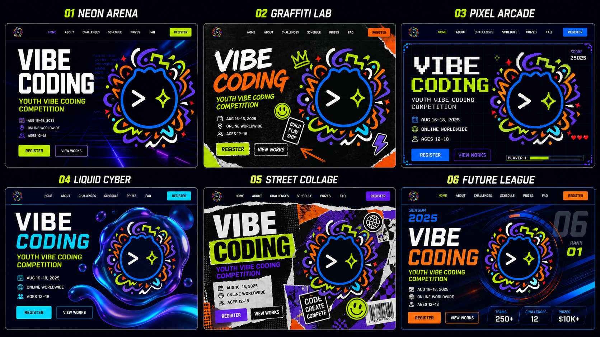

# Vibe Coding 大赛网站视觉方向提案 v0.2

> 当前版本已通过 lark-cli 读取赛事方案，并依据真实定位、赛道、时间线、投稿规则和线上/线下市集机制完成校正。



## 0. 赛事需求解读

这不是一场“比谁代码写得更难”的技术竞赛，而是一场面向公司全员的 AI 创作市集。网站首先要降低非技术参与者的心理门槛，其次才是制造竞技感。

- 主题：Vibe Coding 创作大赛 —— 让想法落地「花」生。
- 人群：公司全员、个人参赛；技术岗位仅参与业务实战赛道。
- 三赛道：业务实战、生活工具、艺术游戏。
- 原则：完成度与体验优先，轻培训、重创作，轻竞技、重展示。
- 核心提交物：可运行作品、1 分钟内演示视频、约 200 字说明、赛道与工具信息。
- 关键节点：8 月 19 日报名、8 月 25 日培训、8 月 28 日中期诊所、9 月 3 日部署帮扶、9 月 7 日交付、9 月 11–14 日线上市集、9 月 14 日线下市集。
- 投票规则：同一用户不能重复投同一作品，但可以投给多个不同作品。
- 产品目标：70+ 报名、50+ 有效作品、10 件优秀作品进入线上市集。

设计关键词因此调整为：**好玩、可参与、创作市集、作品被看见、从想法到落地**。应弱化“硬核程序员”“电子竞技”和过度赛博化表达。

## 1. 品牌视觉解读

Logo 的核心不是单一的“科技感”，而是「代码符号 + 青年文化 + 游戏式爆发力」。视觉资产可拆为四层：

- 核心符号：`>`、星芒、圆形角色/容器轮廓。
- 动势符号：闪电、弧线、箭头、波浪和不规则碎片。
- 品牌色：午夜黑、电子蓝、紫罗兰、酸性荧光绿、橙红、青色、奶油白。
- 质感：圆润但不幼稚，手工感与数字感并存，高对比、强节奏。

建议正式网站始终保留深色基底和高亮品牌色，但每一屏同时出现的高饱和色不超过 3 种，避免 Logo 与页面内容争夺视觉中心。

## 2. 共用信息架构骨架

```text
┌──────────────────────────────────────────────────────────────┐
│ LOGO      大赛介绍   三大赛道   活动日程   作品市集   [登录] │
├──────────────────────────────────────────────────────────────┤
│ 01 HERO                                                     │
│ 让想法落地「花」生 + 报名状态/当前轮次          品牌主视觉    │
│ [立即报名] [浏览作品]                            动态 Logo     │
├──────────────────────────────────────────────────────────────┤
│ 02 PLAYGROUND                                               │
│ 三大赛道卡片 + 有效投稿标准          关键日程 / 创作支持        │
│ 轻竞技重展示 + 全员可参与             70+ / 50+ / 10 漏斗       │
├──────────────────────────────────────────────────────────────┤
│ 03 MARKET                                                   │
│ 线上作品市集 + 奖项预览 + 投票规则 + 最终报名/看作品 CTA      │
├──────────────────────────────────────────────────────────────┤
│ 主办方 / 联系方式 / 隐私说明                                 │
└──────────────────────────────────────────────────────────────┘

二级页面：
报名页 = 飞书登录 → 报名状态查询 → 作品名/赛道 → 成功状态
作品提交页 = 作品链接 → 1 分钟视频 → 200 字说明 → 最终确认
线上市集 = 作品筛选 → 作品详情 → 投票（同人同作品唯一）
```

建议保留“三幕叙事”而不是机械限制为三个 `100vh` 屏幕：第一幕建立兴趣，第二幕解释如何参与，第三幕展示作品与行动。这样能容纳真实赛制，同时保持首页节奏。

## 3. 六套视觉方向

### 01 Neon Arena｜霓虹代码竞技场

定位：把 Vibe Coding 塑造成一场夜间数字竞技盛会。

```text
┌──────── HUD 导航 / 倒计时 ────────┐
│ 巨型标题  代码雨         发光 Logo │
│ 赛程信息  [报名]         透视网格  │
└──── 数据跑马灯 / 当前轮次 ────────┘
```

- 色彩：#070814、#087CFF、#7440E8、#D8FF00、#FFF7D6。
- 字体：窄体粗黑标题 + 等宽数字字体 + 中性中文黑体正文。
- 图形：透视网格、光轨、代码碎片、薄描边 HUD。
- 动效：Logo 呼吸光、网格轻微位移、按钮像能量槽充能。
- 优点：转化路径清楚、技术感强、后续直播和赛程页面易扩展。
- 风险：控制不好会偏电竞，需用圆润 Logo 和奶油白降低攻击性。

### 02 Graffiti Lab｜涂鸦创作实验室

定位：把编程呈现为可涂写、可玩、可共同创作的青年文化。

```text
┌──── 贴纸式导航 ────────────────────┐
│ 手写巨型标题       Logo + 手绘爆炸 │
│ 便签赛事信息       箭头 / 涂鸦轨迹 │
│ [荧光报名贴纸] [作品贴纸]          │
└──── 撕纸分隔 / 涂写式状态条 ──────┘
```

- 色彩：#090811、#7C3AED、#FF6A00、#CFFF00、#1687FF、#FFF4D4。
- 字体：手绘展示字体 + 超粗无衬线 + 清晰中文正文黑体。
- 图形：马克笔笔触、贴纸、胶带、笑脸、手绘箭头和王冠。
- 动效：贴纸轻弹、箭头逐段绘制、卡片像被贴上页面。
- 优点：与 Logo 原生气质最一致，青春、包容、创意感最强。
- 风险：装饰密度需严格分层；表单页必须切换到更克制的子系统。

### 03 Pixel Arcade｜像素闯关街机

定位：把报名、提交、晋级与投票转译成一套游戏进度系统。

```text
┌ SCORE / ROUND / LOGIN ─────────────┐
│ 像素标题             角色化 Logo  │
│ PLAYER 01            状态框 / 血条│
│ [START 报名] [作品榜]              │
└──── 关卡地图 / 当前轮次进度 ──────┘
```

- 色彩：#050816、#1479FF、#8B42F5、#CFFF00、#FF3B30。
- 字体：像素标题 + 等宽 HUD 字体 + 现代中文黑体。
- 图形：像素边框、计分器、生命值、关卡地图、8-bit 图标。
- 动效：加载条、像素闪烁、提交成功后“LEVEL COMPLETE”。
- 优点：比赛机制最容易被年轻用户理解，投票阶段尤其有趣。
- 风险：复古像素是一种强风格，可能限制更成熟或商业类作品的呈现。

### 04 Liquid Cyber｜液态数字未来

定位：更高级、更国际化的青年科技节，强调想象力而非竞技。

```text
┌──────── 极简透明导航 ──────────────┐
│ 巨型标题              液态 Logo 环 │
│ 简介 + 时间            漂浮状态泡泡 │
│ [报名] [了解赛事]                   │
└──── 半透明信息卡 / 柔和光晕 ──────┘
```

- 色彩：#07091B、#14CFFF、#7A3FF2、#BFFF00、#E8E7FF。
- 字体：几何无衬线粗体 + 轻量正文 + 等宽数字。
- 图形：液态环、透明凝胶、玻璃卡片、柔软三维气泡。
- 动效：液体缓慢流动、卡片景深漂浮、光斑随鼠标轻移。
- 优点：完成度和高级感高，能兼容技术、艺术与产品类作品。
- 风险：与常见 AI/未来科技视觉较接近，需要 Logo 的手绘碎片维持独特性。

### 05 Street Collage｜街头拼贴海报

定位：像音乐节与独立杂志一样，把大赛包装成一场青年创作事件。

```text
┌──── 杂志目录式导航 ────────────────┐
│ 撕纸大标题         Logo 海报拼贴   │
│ 胶带信息条         条码 / 网点 /章 │
│ [报名票根] [作品目录]              │
└──── 横向海报跑马灯 ────────────────┘
```

- 色彩：#08080B、#F5F0DA、#B9FF00、#FF5B00、#7138DC。
- 字体：超粗压缩字体 + 杂志衬线点缀 + 中性正文黑体。
- 图形：撕纸、胶带、网点、复印机噪点、票根、条码。
- 动效：海报横向滑动、撕纸遮罩揭示、元素滚动时错位拼接。
- 优点：活动传播性和社交媒体截图效果最强。
- 风险：中文长文和规则内容承载较弱，需要独立的“阅读模式”。

### 06 Future League｜未来创意联赛

定位：将大赛塑造成专业、持续举办、有排名体系的年度赛事品牌。

```text
┌ SEASON / ROUND / RANK ─────────────┐
│ 斜切巨型标题          圆形赛事徽章 │
│ 关键数字 + 赛程        速度线 / 雷达│
│ [加入联赛] [查看选手]              │
└──── TEAM / WORK / PRIZE 数据栏 ───┘
```

- 色彩：#071020、#0E6DFF、#FF6500、#D5FF00、#7A38E8。
- 字体：运动窄体粗黑 + 大号数字 + 高可读正文黑体。
- 图形：斜切面、速度线、雷达圆环、赛季编号、数据条。
- 动效：数字计数、排行榜切换、速度线入场、圆环扫描。
- 优点：专业、秩序感强，适合长期运营、榜单和多轮赛事。
- 风险：容易偏体育或电竞，需增加“创作过程”内容以保持人文感。

## 4. 推荐顺序

| 排名 | 方向 | 品牌匹配 | 青春潮流 | 信息可读 | 后续扩展 | 建议 |
|---|---|---:|---:|---:|---:|---|
| 1 | 02 Graffiti Lab | 5 | 5 | 4 | 4 | 最符合全员创作与“让想法花生”主题 |
| 2 | 05 Street Collage | 5 | 5 | 3 | 4 | 最能表达线上/线下创作市集氛围 |
| 3 | 04 Liquid Cyber | 4 | 4 | 5 | 4 | 信息清晰，适合承载三赛道与复杂规则 |
| 4 | 01 Neon Arena | 3 | 4 | 5 | 5 | 转化强，但需明显弱化电竞与硬核代码感 |
| 5 | 03 Pixel Arcade | 4 | 5 | 4 | 4 | 游戏感突出，适合强调闯关机制 |
| 6 | 06 Future League | 3 | 4 | 5 | 5 | 适合长期联赛化运营 |

## 5. 建议的下一步

优先从 02、05、04 中选 1 个主方向，再选另 1 个作为融合参考。综合赛事定位，首选融合方向为：**02 Graffiti Lab 的品牌语言 + 05 Street Collage 的市集机制 + 04 Liquid Cyber 的信息可读性**。选定后进入：

1. 设计令牌：颜色、字体、圆角、阴影、纹理与图标规范。
2. 首页高保真稿：桌面端 1440px + 移动端 390px。
3. 报名页与参赛信息页组件系统。
4. 动效原型与可访问性检查。
5. 接入正式 Logo 源文件、主海报和奖项物料。

### 预览说明

六套预览图由图像生成工具基于用户提供的 Logo 作为风格参考生成，仅用于创意方向判断。图中的日期、年龄、奖金和英文信息均为占位内容，不应进入正式网站。
